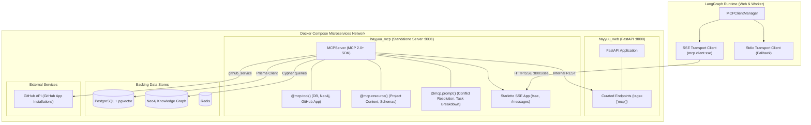

# Hayyuu AI — Standalone Production MCP Server Implementation Plan

## 1. Executive Summary & Audit Findings

### 1.1 Current State Audit (`app/infrastructure/mcp/` & `app/core/mcp_config.json`)
- **What is working**:
  - `MCPClientManager` connects to stdio MCP servers declared in `mcp_config.json` (`db-graph` and `fetch`).
  - `db_graph_server.py` initializes `MCPServer("hayyuu-db-graph")` with database & graph connections in lifespan and exposes 8 functional tools for documents, requirements, tasks, conflicts, suggestions, and Neo4j subgraph traversal.
  - `search_agent/nodes.py` dynamically injects MCP tools into Gemini 3.8 Flash function declarations and executes tool calls in parallel with `asyncio.gather`.
  - Basic integration test in `test_mcp_integration.py` successfully connects to `db-graph` and executes `list_project_documents`.
- **What is incomplete / hacky / missing**:
  - **Single-Tenant / Broken GitHub Tool**: `db_graph_server.py`'s `create_github_issue` attempts to read `owner.githubToken` (deprecated OAuth). Meanwhile, Hayyuu AI's actual backend has a full-featured `GitHubService` (`app/infrastructure/github/github_service.py`) using GitHub App installations (`project.githubInstallationId`).
  - **Missing MCP Primitives**: Only `@mcp.tool()` is implemented. MCP **Resources** (`@mcp.resource()`) and **Prompts** (`@mcp.prompt()`) are completely missing.
  - **Transport Limitation**: `MCPClientManager` is hardcoded to `stdio_client` (spawning child subprocesses). It has zero support for network transports (SSE / Streamable HTTP) required for containerized microservices.
  - **No Tag-Based Route Filtering**: No mechanism exists to selectively expose curated FastAPI endpoints (`tags=["mcp"]`) to LLM agents without overloading context windows with 50+ CRUD endpoints.
  - **Missing Docker Containerization**: The MCP server is executed as a local subprocess rather than a first-class citizen service in `docker-compose.yaml`.

---

## 2. Trade-Off Analysis & Recommended Architecture

### 2.1 GitHub Tools Evaluation

| Dimension | Option 1: `npx @modelcontextprotocol/server-github` | Option 2: Docker `mcp/github` | **Recommended: Native Curated Tools via `github_service`** |
| :--- | :--- | :--- | :--- |
| **Multi-Tenancy** | ❌ Hardcoded to single global PAT via env var | ❌ Single PAT per container instance | ✅ **Dynamic multi-tenant installation token per project via `github_service.get_token_for_project(project_id)`** |
| **Dependencies** | Requires Node.js/npm inside Python container | Requires extra container per user | ✅ **Zero extra dependencies (uses existing Python `httpx` & cryptography)** |
| **Token Handling** | Static PAT | Static PAT | ✅ **Automatic token expiration refresh & GitHub App permission scoping** |
| **Docker Networking** | Subprocess inside container | Extra bridge network container | ✅ **Integrated into `hayyuu_mcp` standalone container** |

**Decision**: Implement curated GitHub tools directly in Hayyuu's MCP server utilizing the existing `github_service.py` to maintain multi-tenant security and zero container bloat.

### 2.2 FastAPI Endpoints Exposure Evaluation

| Dimension | Approach 1: OpenAPI-to-MCP Proxy | **Approach 2: Tag-Filtered Route Curating (`tags=["mcp"]`)** |
| :--- | :--- | :--- |
| **Context Window Impact** | ❌ Catastrophic: 50+ CRUD endpoints consume 20,000+ tokens per LLM turn | ✅ **Minimal: 5–8 targeted tools consume <1,500 tokens (90% reduction)** |
| **Agent Reasoning** | Confuses model with admin/auth routes (login, refresh, webhooks) | Focused strictly on domain queries (requirements, tasks, conflicts) |
| **Protocol Support** | Tools only | Exposes **Tools**, **Resources**, and **Prompts** |
| **Auth/State Injection** | Hard to pass LangGraph thread context dynamically | Natively resolves `project_id` and user permissions |

**Decision**: **Approach 2**. Expose only curated routes decorated with `tags=["mcp"]` and custom `@mcp.tool()` endpoints.

---

## 3. Target Architecture Diagram



---

## 4. Phased Implementation Roadmap

### Phase 1: Standalone MCP Server Core & Primitives (Tools, Resources, Prompts)
- **Goal**: Transition from script-based `db_graph_server.py` to a modular, production-ready server supporting Tools, Resources, and Prompts with SSE/HTTP readiness.
- **Tasks**:
  1. Refactor `app/infrastructure/mcp/` structure:
     - `server.py`: Server factory, lifespan connection handlers, and SSE Starlette application initialization.
     - `tools/db_graph_tools.py`: Modularized database and Neo4j tools.
     - `resources/project_resources.py`: MCP Resources (`hayyuu://projects/{project_id}/summary`, `hayyuu://projects/{project_id}/schema`).
     - `prompts/agent_prompts.py`: MCP Prompts (`analyze_conflicts`, `task_breakdown_spec`).
  2. Implement FastAPI route tag filtering (`tags=["mcp"]`) proxy helper.
  3. Verify with standalone runner and automated unit tests.
- **Acceptance Criteria**:
  - `MCPServer` initializes cleanly with lifespan management.
  - Lists and returns all Tools, Resources, and Prompts.
  - Automated tests pass for tools, resources, and prompts.

### Phase 2: Multi-Tenant GitHub Integration & Complete Tool Suite
- **Goal**: Implement complete multi-tenant GitHub MCP tool suite (21 standard tools) hooked into `github_service.py` with project-level installation token scoping.
- **Tasks**:
  1. Build modular GitHub MCP tools provider (`app/infrastructure/mcp/tools/github_tools.py`) powered by `github_service.get_token_for_project(project_id)`.
  2. Implement the full 21-tool GitHub suite:
     - **Files & Code**:
       - `get_file_contents(project_id, repo, path, ref)`
       - `search_code(project_id, query)`
     - **Issues & Discussions**:
       - `list_issues(project_id, repo, state, sort, direction, per_page, page)`
       - `get_issue(project_id, repo, issue_number)`
       - `create_issue(project_id, repo, title, body, assignees, labels, milestone)`
       - `update_issue(project_id, repo, issue_number, title, body, state, assignees, labels, milestone)`
       - `add_issue_comment(project_id, repo, issue_number, body)`
     - **Pull Requests & Code Reviews**:
       - `list_pull_requests(project_id, repo, state, head, base, sort, direction, per_page, page)`
       - `get_pull_request(project_id, repo, pull_number)`
       - `create_pull_request(project_id, repo, title, head, base, body, draft)`
       - `update_pull_request(project_id, repo, pull_number, title, body, state, base)`
       - `merge_pull_request(project_id, repo, pull_number, commit_title, commit_message, merge_method)`
       - `create_pull_request_review(project_id, repo, pull_number, body, event, comments)`
     - **Branches & Commits**:
       - `list_branches(project_id, repo, protected, per_page, page)`
       - `get_branch(project_id, repo, branch)`
       - `create_branch(project_id, repo, branch, sha)`
       - `list_commits(project_id, repo, sha, path, author, since, until, per_page, page)`
       - `get_commit(project_id, repo, ref)`
     - **Repositories**:
       - `search_repositories(project_id, query, sort, order, per_page, page)`
       - `create_repository(project_id, name, description, private, auto_init)`
       - `fork_repository(project_id, repo, organization)`
  3. Implement GitHub-specific MCP Prompts:
     - `github_pr_review_template`
     - `github_issue_spec_template`
  4. Write comprehensive integration tests verifying dynamic token resolution, parameter serialization, and error handling for all 21 tools.
- **Acceptance Criteria**:
  - Validates repository ownership and project installation ID before API calls.
  - All 21 GitHub tools execute using dynamic tokens without static PAT env vars.
  - Full test coverage for issue management, PR operations, git tree navigation, and code search.

### Phase 3: Client Manager SSE Network Transport & LangGraph Handshake
- **Goal**: Enable `MCPClientManager` to connect to remote MCP servers over SSE transport while keeping stdio fallback.
- **Tasks**:
  1. Update `app/core/mcp_config.json` schema to support:
     ```json
     {
       "mcpServers": {
         "hayyuu-mcp": {
           "transport": "sse",
           "url": "http://hayyuu_mcp:8001/sse"
         }
       }
     }
     ```
  2. Update `MCPClientManager` to support both `stdio_client` and `sse_client`.
  3. Add client discovery & invocation methods for:
     - `list_resources()`, `read_resource(uri)`
     - `list_prompts()`, `get_prompt(name, arguments)`
  4. Integrate MCP Resources and Prompts into `search_agent` and LangGraph state.
  5. Run integration tests testing the client-server handshake over SSE.
- **Acceptance Criteria**:
  - `MCPClientManager` connects over HTTP/SSE.
  - Discovers tools, resources, and prompts over the network.
  - LangGraph agent successfully executes tools via SSE client session.

### Phase 4: Dockerization & End-to-End Testing
- **Goal**: Create standalone Docker container for `hayyuu_mcp` and integrate it into `docker-compose.yaml`.
- **Tasks**:
  1. Create `Dockerfile.mcp` (or reuse optimized multi-stage build).
  2. Add `hayyuu_mcp` service in `docker-compose.yaml`:
     - Exposes port 8001.
     - Connects to `postgres`, `redis`, and `neo4j`.
     - Configures healthcheck on `/sse` or `/health`.
  3. Update `hayyuu_web` environment to point to `http://hayyuu_mcp:8001/sse`.
  4. Execute end-to-end integration tests verifying containerized operation.
- **Acceptance Criteria**:
  - `docker compose up` starts `hayyuu_mcp` healthy.
  - `hayyuu_web` and workers seamlessly communicate with `hayyuu_mcp` over internal Docker network.
  - All automated test suites pass.
