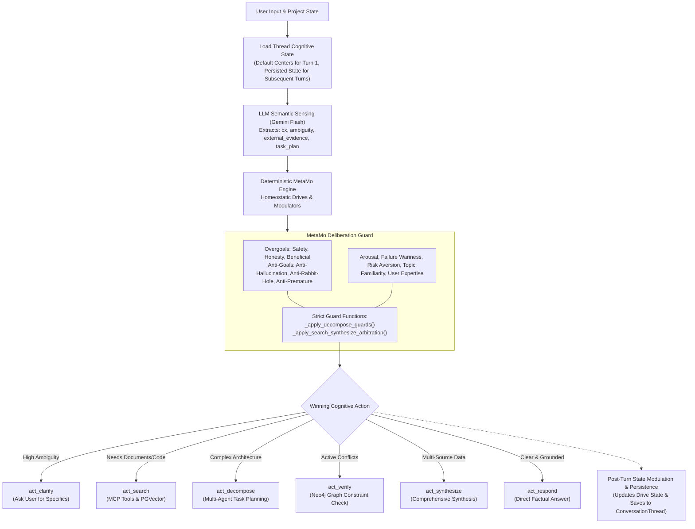
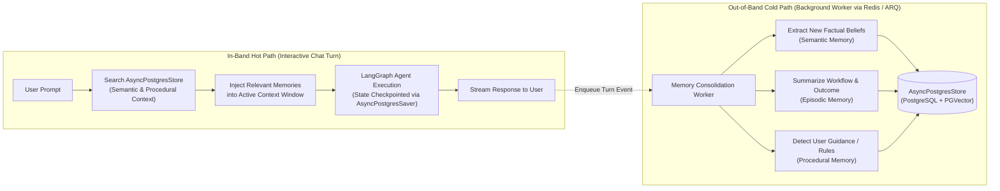
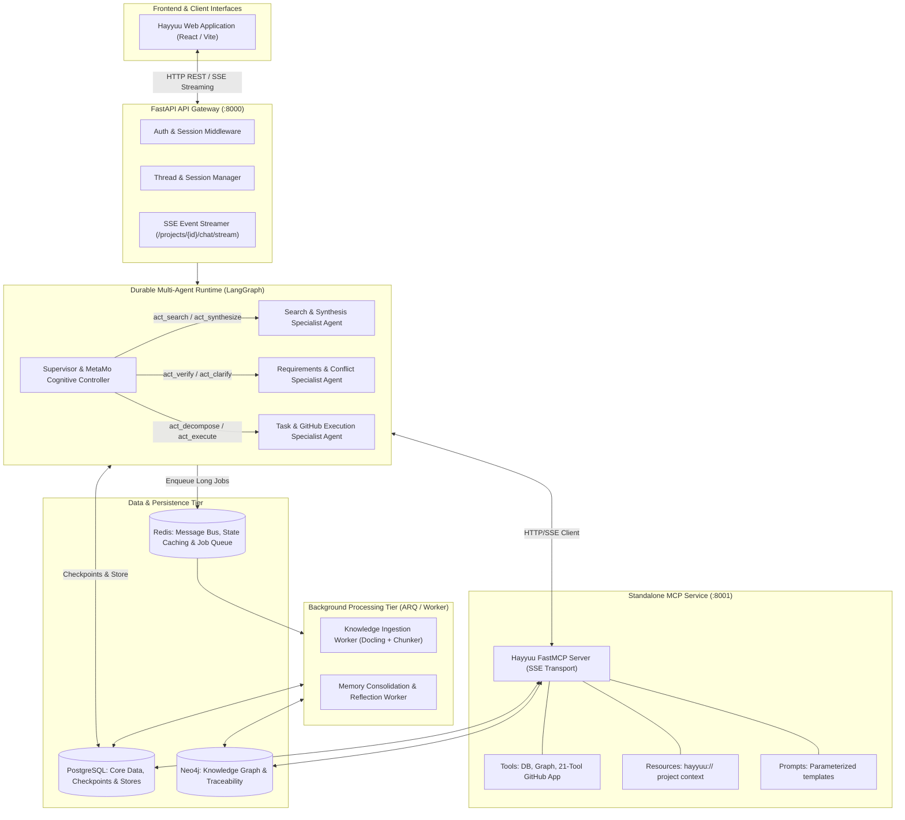
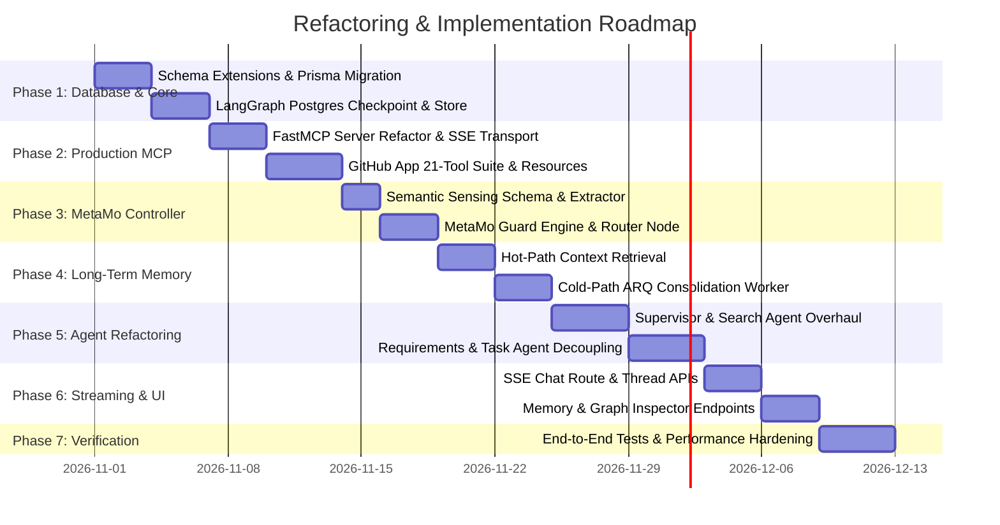

# Hayyuu AI — Comprehensive Agent Architecture Refactoring & Implementation Plan

---

## 1. Executive Summary & Architectural Vision

### 1.1 Purpose of Refactoring
The current agent implementations in **Hayyuu AI** ([`hayyuu-backend/app/agents/`](file:///c:/Users/haile/OneDrive/Desktop/MY-File/NEW_SKILLS/AI/AI-AGENT/Hayyuu%20AI/hayyuu-backend/app/agents)) operate as isolated, linear pipelines. They lack conversational continuity, fail to retain long-term project memory, execute blocking operations inside HTTP request lifecycles, and lack a cognitive deliberation layer to prevent hallucinations, infinite tool loops, or premature responses.

This refactoring plan establishes a unified, production-grade, multi-agent cognitive architecture based on four foundational pillars:
1. **Enterprise Long-Term Agentic Memory (LangGraph & LangMem)**: Dual-path memory architecture (In-Band Hot Path for real-time contextual recall + Out-of-Band Cold Path for background memory consolidation via Redis/ARQ), backed by PostgreSQL (`AsyncPostgresStore` / `AsyncPostgresSaver`) with strictly partitioned multi-tenant namespaces.
2. **MetaMo Hybrid Cognitive Controller & Motivation Engine**: A metacognitive deliberation engine combining lightweight LLM semantic perception with deterministic homeostatic motivation guards (PSI theory) to arbitrate actions (`act_clarify`, `act_search`, `act_think`, `act_decompose`, `act_synthesize`, `act_verify`, `act_respond`). Includes **Dynamic Response Style Shaping** (concise, thorough, cautious, tutorial, exploratory), **Cold-Start Blending**, **Dual-Loop Failure Decay**, **Homeostatic Contractivity with Hard Safety Floors ($\theta_{\text{safe}} = 0.55$)**, **Top-3 Competing Action Telemetry**, and an **Automated Multi-Turn Evaluation Harness (`runner.py`)** for CI/CD regression testing.
3. **Standalone Production MCP Server (Anthropic MCP)**: Decoupling tools, URI-based resources (`hayyuu://`), and parameterized prompts into an independently deployable microservice running over **Server-Sent Events (SSE)** / Streamable HTTP, with project-scoped multi-tenant GitHub App operations.
4. **Dual-Store Knowledge Engine (Neo4j Property Graph + PGVector)**: Labeled property graph traversals for structural traceability, dependency mapping, and impact analysis, combined with dense vector embeddings for semantic chunk retrieval.

---

## 2. Audit & Analysis of Existing Architecture & Limitations

### 2.1 Current Implementation State

```
Current Flow (Fragile / Ephemeral):
Client Request ──> POST /projects/{id}/chat ──> Generate random uuid() Thread ID
                                            └──> Run search_agent synchronously
                                            └──> Neo4j vector search + Cypher
                                            └──> Direct Gemini tool call (stdio MCP)
                                            └──> Returns single JSON (State lost forever)
```

| Component | Current State | Critical Limitations & Deficiencies |
| :--- | :--- | :--- |
| **`search_agent`** | Cyclic LangGraph graph with vector lookup, Lucene regex search, and MCP tool loop. | **1. Ephemeral Sessions**: Uses `thread_id = f"{project_id}-search-{uuid.uuid4()}"` per turn, throwing away checkpoints and conversational history.<br>**2. No Memory**: Cannot recall past user decisions, architectural preferences, or previous turns.<br>**3. Blocking HTTP**: Runs directly inside FastAPI request cycle without streaming (SSE) or background worker decoupling.<br>**4. Prompt Bloat**: Hardcodes 300+ lines of prompt text inside Python node code. |
| **`knowledge_builder`** | Waterfall graph: `preprocess` $\rightarrow$ `embed` $\rightarrow$ `extract` $\rightarrow$ `store_vectors` $\rightarrow$ `store_graph` $\rightarrow$ `save_results`. | **1. No Self-Correction**: Zero reflection or validation if entity extraction hallucinates or fails.<br>**2. High Latency**: Single monolithic execution rather than chunk-level pipelining.<br>**3. No Semantic Memory Generation**: Stores raw chunks and graph nodes, but extracts no generalizable project facts. |
| **`requirements_extractor`** | Fork graph ingesting files via Gemini File API and extracting requirements/conflicts. | **1. Un-grounded Extraction**: Operates without cross-referencing existing project requirements, creating duplicate suggestions.<br>**2. Missing Human-in-the-Loop**: No pause/resume checkpoints for human approval before persisting to PostgreSQL. |
| **MCP Infrastructure** | Standalone server in [`app/infrastructure/mcp/`](file:///c:/Users/haile/OneDrive/Desktop/MY-File/NEW_SKILLS/AI/AI-AGENT/Hayyuu%20AI/hayyuu-backend/app/infrastructure/mcp) with FastMCP, Starlette SSE transport, 33 registered tools (DB, Graph, 22 multi-tenant GitHub App tools), 3 resources (`hayyuu://`), and 5 prompts. | **Agent Integration & Context Budgeting Gaps**:<br>**1. Agent-Side Underutilization**: Agents only invoke tools via `available_tools` in `search_agent`; they do not yet consume MCP **Resources** or **Prompts** in reasoning loops.<br>**2. No Context Budgeting**: Lacks token-budget controls and intent-gated lazy loading to prevent full project resource dumps from bloating LLM context windows.<br>**3. Deployment Wiring**: Service is not yet containerized as a standalone container in `docker-compose.yaml`. |
| **Database Schema** | Prisma schema covering `User`, `Project`, `Document`, `Requirement`, `Task`, `Conflict`. | **Missing Core Agent Models**: No schema models for `ConversationThread`, `ChatMessage`, `MemoryRecord` (Semantic/Episodic), or `AgentWorkflowRun`. |

---

## 3. Research Synthesis & Architectural Foundations

### 3.1 Pillar 1: MetaMo Cognitive Motivation & Routing Engine
Adapted from [`PLN_RAG-MetaMo-Integration/MetaMo-Prototype`](file:///c:/Users/haile/OneDrive/Desktop/MY-File/NEW_SKILLS/AI/INTERN/Qwestor/PLN_RAG-MetaMo-Integration/MetaMo-Prototype):



#### Hybrid Cognitive Controller Design (Option 2B)
1. **Thread-Level Cognitive State Persistence & Continuity**:
   - **Turn 1 (New Conversation)**: The engine initializes from baseline **default activation centers** (`DEFAULT_CENTERS`: `arousal=0.40`, `securing=0.30`, `risk_aversion=0.40`, `failure_wariness=0.10`, `topic_familiarity=0.50`, `user_expertise=0.50`, etc.).
   - **Subsequent Turns (Ongoing Conversation)**: The engine does **not** reset to default. Instead, it reloads the **persisted cognitive motivation state** saved with the active `ConversationThread` from the previous turn.
   - **Post-Turn Modulation**: After each turn, a post-decision step modulates the drives:
     - Technical dialogue increases `topic_familiarity` and calibrates `user_expertise`.
     - Ambiguities, errors, or conflict warnings elevate `failure_wariness` and `securing`.
     - Successful resolutions decrease `arousal` and restore homeostatic balance.
   - **Persistence Target**: Saved directly to `ConversationThread.cognitiveState` (JSON) and checkpointed in LangGraph's persistent state via `AsyncPostgresSaver`.

2. **Cold-Start Blending Engine**:
   - During turns 1 and 2 of a new conversation or project context, running exponential moving averages have not yet accumulated enough momentum.
   - MetaMo introduces a **cold-start horizon** ($H = 2$ turns) with strength $S = 0.70$:
     $$\text{cold\_phase} = \frac{H - \text{turn\_count}}{H}, \quad \text{cold\_weight} = \text{clamp}(S \times \text{cold\_phase}, 0.0, 1.0)$$
   - The effective modulators blend the immediate sensory context signals with the baseline:
     $$M_{\text{effective}} = (1 - \text{cold\_weight}) \cdot M_{\text{running}} + \text{cold\_weight} \cdot M_{\text{signal}}$$
   - This ensures the agent reacts with instant responsiveness to user urgency or complexity on Turn 1, smoothly handing off to stable long-term momentum by Turn 3+.

3. **Dual-Loop Learning with Modulator Alphas & Dynamic Failure Decay**:
   - Every modulator updates smoothly per turn using calibrated learning rates ($\alpha$):
     $$M_{t+1} = (1 - \alpha_M) M_t + \alpha_M \cdot \text{Target}_M$$
   - Crucially, `failure_wariness` features explicit **`failure_decay`** mechanics:
     $$W_{t+1} = (1 - \text{failure\_decay}) W_t + \alpha_{\text{fail}} \cdot \text{FailureSignal}$$
   - When a tool execution errors, a validation fails, or a user corrects an agent output, `failure_signal` spikes to $1.0$, immediately increasing wariness and forcing verification. As subsequent turns succeed, `failure_decay` smoothly restores the agent to normal homeostatic equilibrium.

4. **Homeostatic Contractivity with Hard Safety Floors ($\theta_{\text{safe}} = 0.55$)**:
   - In long refactoring sessions (20+ turns), internal variables could drift to pathological extremes (e.g., permanent paranoia refusing to answer).
   - When state variables drift near upper/lower boundaries ($\le lo + \eta$ or $\ge hi - \eta$), contractive forces pull them back toward `DEFAULT_CENTERS`:
     $$M_{\text{contracted}} = (1 - \alpha_{\text{near}}) M + \alpha_{\text{near}} \cdot \text{Center}_M$$
   - Overgoals (`over_safety`, `over_honesty`, `over_beneficial`) possess a non-negotiable **Hard Safety Floor**:
     $$\theta_{\text{safe}} = 0.55$$
     Regardless of adversarial prompting or extended conversational turns, safety and honesty can *never* decay below $0.55$.

5. **Dynamic Response Style Shaping (`style.py`)**:
   - MetaMo does not stop at choosing the action; when generating a response, it deterministically computes an optimal **Style Modifier**:
     - **`style_concise`**: Selected when urgency is high, complexity is low, and ambiguity is low (direct bullet points, zero conversational filler).
     - **`style_thorough`**: Selected when complexity is high, resolution is high, and urgency is low (comprehensive architectural breakdown).
     - **`style_cautious`**: Selected when threshold is high, confidence is low, failure wariness is high, or verify request is present (explicitly calls out assumptions, trade-offs, and verification steps).
     - **`style_tutorial`**: Selected when user expertise is low ($ux \le 0.4$) (beginner-friendly language, explains underlying engineering concepts).
     - **`style_exploratory`**: Selected when creativity and approach are high while risk aversion is low (evaluates novel, non-obvious design choices).
   - Fulfills **SRS Module D (AI Chat Persona)** and **FR-O-007 (Context Management)**.

6. **Cognitive Deliberation Telemetry & Competing Top-3 Action Scoring**:
   - MetaMo calculates scores across all candidate actions and outputs:
     - Winning action (`action`)
     - Assigned response style modifier (`style_modifier`)
     - Top-3 competing scores (`score_top3`, e.g., `act_clarify: 0.88 | act_search: 0.72 | act_respond: 0.41`)
     - Human-readable explanation (`reason`, e.g., *"Decompose blocked because ambiguity (0.65) exceeds threshold; forced Clarify due to anti-premature guard"*)
   - Persisted directly into `ChatMessage.cognitiveTelemetry` and exposed to the frontend via **SRS Module L (AI Memory & Knowledge Inspector)**, making the agent fully explainable and auditable.

7. **Semantic Sensing Turn**: A lightweight, deterministic JSON-schema Gemini call extracts environmental indicators:
   - `complexity` ($c_x \in [0.0, 1.0]$): Structural difficulty of the query.
   - `ambiguity` ($a \in [0.0, 1.0]$): Level of underspecification or missing constraints.
   - `needs_external_evidence` ($e \in [0.0, 1.0]$): Whether project documentation, files, or GitHub state must be checked.
   - `needs_task_plan` ($p \in [0.0, 1.0]$): Whether the query requests implementation, refactoring, or multi-step execution.
   - `verify_request` ($\text{bool}$): Whether strict verification or conflict checking is requested.

8. **Deterministic Mathematical Arbitration**: MetaMo's guard algorithms strictly filter and score actions based on the thread's active cognitive state:
   - *Anti-Premature Guard*: If $a \ge 0.60$, `act_decompose` and `act_respond` are strictly blocked ($\text{score} = -999.0$), forcing `act_clarify`.
   - *Anti-Rabbit-Hole Guard*: Caps search depth and penalizes repeated tool execution when new evidence drops below the utility threshold.
   - *Anti-Hallucination Guard*: If evidence confidence is low and `act_respond` is attempted, the system triggers `act_verify` against Neo4j relationships.

### 3.2 Pillar 2: Long-Term Agentic Memory with LangGraph
Fulfills **SRS Module E (Memory System)** and **Module L (Memory Inspector)**:



#### The Memory Modalities
1. **Working Memory**: Active LangGraph state scratchpad (scratch variables, intermediate tool outputs, current execution step).
2. **Short-Term Memory**: Conversation thread message history, maintained reliably by `AsyncPostgresSaver` keyed by a persistent `thread_id` (representing a user chat session).
3. **Long-Term Semantic Memory**: Factual propositions about the project (e.g., *"The frontend uses Tailwind CSS v4"*, *"JWT refresh tokens expire in 7 days"*), stored as embedded records in namespace `(user_id, project_id, "semantic")`.
4. **Long-Term Episodic Memory**: Past workflow experiences, problem-solution pairs, and conflict resolution events (e.g., *"On 2026-10-24, resolved conflict between REQ-004 and REQ-009 by making auth optional for public docs"*), stored in namespace `(user_id, project_id, "episodic")`.
5. **Long-Term Procedural Memory**: System prompt customizations, rules, and behavioral guidelines learned from explicit user corrections, stored in namespace `(user_id, "procedural")`.

#### 3.2.1 Two-Tier Chat Memory & Traversal Architecture
To ensure high-performance chat rendering and deep historical inspection without polluting the knowledge graph, chat history is handled exclusively in PostgreSQL via a two-tier hierarchy:

```
┌───────────────────────────────────────────────────────────────────────────────────────┐
│                      TWO-TIER CHAT MEMORY & TRAVERSAL HIERARCHY                       │
├───────────────────────────────────────────┬───────────────────────────────────────────┤
│    Tier 1: Distilled Episodic Memory      │    Tier 2: Raw Conversation Logs & MCP    │
│      (AsyncPostgresStore in Postgres)     │          (chat_messages in Postgres)      │
├───────────────────────────────────────────┼───────────────────────────────────────────┤
│ • Automated, in-band context injection    │ • System of record for UI & audit trail   │
│ • Summarizes past decisions & outcomes    │ • Retains exact verbatim dialogue turns   │
│ • Zero tool-call overhead on normal turns │ • Dense PGVector embeddings per message   │
│ • Solves 90% of cross-turn queries        │ • On-demand MCP traversal tools:          │
│                                           │   - get_chat_history(range, limit)        │
│                                           │   - search_chat_history(semantic_query)   │
└───────────────────────────────────────────┴───────────────────────────────────────────┘
```

- **Strict Separation of Concerns**: Neo4j does **not** store raw chat messages or conversation threads. Neo4j is reserved purely for the **Project Domain Knowledge Graph** (`Requirement`, `Task`, `Document`, `Component`, `CodeFile`). Everything conversational (streaming logs, embeddings, checkpoints, and episodic memories) is consolidated in **PostgreSQL**.
- **Execution Flow**:
  1. *Common Case (Past Decisions)*: The agent checks Tier 1 (Episodic Memory) during prompt assembly and immediately knows past agreements with zero extra database queries.
  2. *Deep Inspection Case (Verbatim Quotes / Range Slices)*: If the user asks for exact verbatim statements or dialogue from many turns ago, the agent invokes Tier 2 MCP tools (`search_chat_history` or `get_chat_history`) on PostgreSQL.

### 3.3 Pillar 3: Standalone Production MCP Microservice
Fulfills **SRS Module N (AI Tool System & MCP Compatibility)**:
- **Architecture**: A standalone microservice container (`hayyuu_mcp`) built on Starlette and FastMCP exposing an HTTP/SSE endpoint (`/sse` and `/messages`) with health check (`/health`) and CORS management (already implemented in [`app/infrastructure/mcp/`](file:///c:/Users/haile/OneDrive/Desktop/MY-File/NEW_SKILLS/AI/AI-AGENT/Hayyuu%20AI/hayyuu-backend/app/infrastructure/mcp)).
- **The Three MCP Primitives**:
  1. **Tools (`@mcp.tool()`)**:
     - *Database Query & Inspection Tools (Existing + Expanded)*:
       - Documents: `list_project_documents`, `get_document_metadata`, `get_document_parsing_status`.
       - Requirements: `list_project_requirements`, `get_requirement_details`, `create_project_requirement`, `update_requirement_status`.
       - Tasks: `list_project_tasks`, `get_task_details`, `create_project_task`, `update_task_status`, `update_task_details`, `assign_task_to_requirement`.
       - Conflicts: `list_project_conflicts`, `get_conflict_details`, `resolve_requirement_conflict`.
       - Suggestions & Repositories: `list_project_suggestions`, `apply_ai_suggestion`, `reject_ai_suggestion`, `list_project_repositories`, `get_project_overview`.
       - Chat History & Traversal: `get_chat_history(thread_id, range, limit)`, `search_chat_history(query, project_id, thread_id, limit)`.
     - *Graph Tools*: `traverse_project_subgraph`, `get_project_graph_summary`, `find_impacted_dependencies`.
     - *GitHub App Suite (22 tools)*: Modular tools powered by `github_service.get_token_for_project(project_id)` (issues, pull requests, file contents, code search, branches, commits, repo operations).
  2. **Resources (`@mcp.resource()`) & Context Window Optimization**:
     - Standard URIs:
       - `hayyuu://projects/{project_id}/summary`: High-level project metadata, tech stack, and document counts.
       - `hayyuu://projects/{project_id}/schema`: Relational and graph schema context.
       - `hayyuu://projects/{project_id}/conflicts/active`: Real-time active conflict register.
       - `hayyuu://system/capabilities`: System tools and model execution boundaries.
     - **Context Window Optimization Strategy**:
       - *The Problem*: Indiscriminately dumping full project resources (full document bodies, 50+ raw requirements, massive schemas) into the prompt context wastes 15,000–30,000 tokens, inflates latency, and causes "lost in the middle" attention failure.
       - *Tiered / Lazy Ingestion*:
         - **Tier 1 (Base Anchor - Always Included)**: `hayyuu://projects/{project_id}/summary` (<300 tokens) provides essential orientation.
         - **Tier 2 (Intent-Gated Dynamic Inclusion)**: Only attach specialized resources when selected by MetaMo:
           - Load `conflicts/active` only when MetaMo selects `act_verify` or conflict analysis is requested.
           - Load `schema` only when queries involve architecture, data modeling, or database migrations.
       - *Compact Anchor Representations*: Resources format entities as token-efficient index tables (ID, Title, Status, 1-line summary) consuming $<30$ tokens per item. Full textual bodies are fetched on-demand via targeted database tools (`get_requirement_details`, `get_task_details`).
       - *Strict Context Budget Ceiling*: Enforce an upper ceiling (max 15–20% of context window, ~2,500 tokens) with priority-based trimming.
  3. **Prompts (`@mcp.prompt()`)**:
     - `analyze_conflicts`: Pre-tuned prompt template for requirement conflict resolution.
     - `task_breakdown_spec`: Standardized prompt template for decomposing requirements into sprint tasks.
     - `architecture_synthesis`: High-level C4 model and blueprint synthesis template.
     - `github_pr_review_template` & `github_issue_spec_template`: Standardized templates for Git operations.

### 3.4 Pillar 4: Dual-Store Knowledge Engine (Neo4j + PGVector)
- **PGVector (Neon PostgreSQL Extension)**:
  - Stores 500-token document chunks with 100-token overlaps, embedded via Gemini `text-embedding-004`.
  - Performs cosine similarity search for unstructured text extraction.
- **Neo4j Graph Database**:
  - Stores labeled entities: `(:Requirement)`, `(:Task)`, `(:Document)`, `(:CodeFile)`, `(:Component)`.
  - Stores typed relationships: `[:IMPLEMENTS]`, `[:DEPENDS_ON]`, `[:CONFLICTS_WITH {severity, status}]`, `[:REFERENCES]`.
  - Executes sub-10ms Cypher queries to compute dependency paths, traceability matrices, and circular dependency checks.
  - Feeds graph nodes and edges directly into the Module L visualizer API.

---

## 4. Target Architecture & Agent Responsibilities

### 4.1 System Topology Diagram



### 4.2 Agent Responsibilities & Topology

#### 1. Supervisor & MetaMo Cognitive Controller Agent
- **Role**: Primary entry point for all project interactions.
- **Responsibilities**:
  - Ingests user input and loads short-term thread context (`AsyncPostgresSaver`).
  - Queries `AsyncPostgresStore` for relevant long-term semantic, episodic, and procedural memories.
  - Runs the **MetaMo Semantic Sensing Turn** to extract environmental signals (`cx`, `ambiguity`, `needs_external_evidence`).
  - Evaluates MetaMo homeostatic drives and guard rules to select the winning cognitive action.
  - Dispatches execution to specialized sub-agents or returns a clarified/direct response to the user.

#### 2. Search & Synthesis Specialist Agent
- **Role**: Deep project intelligence, RAG, and document Q&A.
- **Responsibilities**:
  - Retrieves semantic chunks from PGVector.
  - Pulls contextual subgraphs from Neo4j using MCP graph traversal tools.
  - Resolves multi-source evidence and synthesizes comprehensive, factual, traceable answers with citations.
  - Enforces `anti_hallucinate` bounds by rejecting claims not grounded in retrieved context.

#### 3. Requirements & Conflict Specialist Agent
- **Role**: Product requirements analysis and structural conflict detection.
- **Responsibilities**:
  - Parses uploaded document text into structured functional and non-functional requirements.
  - Cross-references incoming requirements against existing project requirements in Neo4j to detect duplicates or contradictions (`CONFLICTS_WITH`).
  - Generates AI suggestions for conflict resolution and flags severity (`HIGH`, `MEDIUM`, `LOW`).
  - Manages human-in-the-loop review nodes before approval.

#### 4. Task & GitHub Execution Specialist Agent
- **Role**: Engineering task management, sprint breakdown, and repository synchronization.
- **Responsibilities**:
  - Decomposes approved requirements into engineering tasks with dependencies and priorities (`P0`, `P1`, `P2`).
  - Invokes the 21-tool GitHub MCP suite using dynamically generated GitHub App installation tokens.
  - Creates, updates, and links GitHub issues and pull requests to internal project tasks.

#### 5. Background Knowledge Ingestion Worker
- **Role**: Asynchronous document layout extraction and index population.
- **Responsibilities**:
  - Converts PDF, DOCX, and TXT files using Docling to extract structural layouts, tables, and section hierarchies.
  - Splits text into 500-token chunks with 100-token overlaps.
  - Inserts vector embeddings into PGVector and `MERGE`s entities/relationships into Neo4j.

#### 6. Background Memory Consolidation Worker
- **Role**: Continuous post-interaction learning and reflection.
- **Responsibilities**:
  - Listens for completed conversation threads and workflow runs.
  - Extracts new semantic beliefs and user preferences, upserting them into `AsyncPostgresStore`.
  - Records episodic problem-solution pairs for future retrieval.
  - Recalibrates procedural guidelines based on user approvals or corrections.

---

## 5. Detailed Integration Strategies

### 5.1 Memory Subsystem Strategy
- **Store Configuration**:
  - LangGraph `AsyncPostgresStore` connected to Neon PostgreSQL.
  - Semantic index on memory value payloads using PGVector (`vector(768)`).
- **Namespaces**:
  - `(user_id, project_id, "semantic")`: Keyed by entity or topic (e.g., `architecture/auth`, `preferences/language`).
  - `(user_id, project_id, "episodic")`: Keyed by run ID or ISO timestamp (e.g., `episodes/2026-10-31-refactor-auth`).
  - `(user_id, "procedural")`: Keyed by workflow category (e.g., `guidelines/code_style`, `guidelines/task_formatting`).
- **Retrieval & Context Injection**:
  - At the start of each chat turn, the Supervisor performs a hybrid keyword + vector search over the project’s memory namespace:
    ```python
    memories = await store.asearch(
        (user_id, project_id),
        query=user_prompt,
        limit=5
    )
    ```
  - Formatted memories are injected into the system prompt under a dedicated `<project_memory>` block.
- **Out-of-Band Consolidation**:
  - On thread completion or after every 5 conversational turns, a background job is enqueued to Redis:
    ```python
    await redis_pool.enqueue_job("consolidate_memory_job", thread_id, project_id, user_id)
    ```

- **Two-Tier Chat Traversal Collaboration**:
  - **Tier 1 (Episodic Memory Injection)**: The Supervisor automatically resolves high-level decisions (e.g., *"We decided to use Argon2 and 15-minute JWTs"*) at turn initialization with zero tool latency.
  - **Tier 2 (On-Demand MCP Traversal on PostgreSQL)**: When verbatim dialogue or sequential turn context is requested, the agent invokes dedicated MCP tools:
    ```python
    # app/infrastructure/mcp/tools/db_graph_tools.py

    @mcp.tool()
    async def get_chat_history(
        thread_id: str,
        limit: int = 10,
        before_message_id: Optional[str] = None,
        after_message_id: Optional[str] = None
    ) -> str:
        """Retrieves chronological messages from a thread for historical inspection."""
        limit = min(limit, 25)
        where: dict = {"threadId": thread_id}
        if before_message_id:
            target = await prisma.chatmessage.find_unique(where={"id": before_message_id})
            if target:
                where["createdAt"] = {"lt": target.createdAt}
        elif after_message_id:
            target = await prisma.chatmessage.find_unique(where={"id": after_message_id})
            if target:
                where["createdAt"] = {"gt": target.createdAt}

        messages = await prisma.chatmessage.find_many(
            where=where,
            take=limit,
            order={"createdAt": "desc" if before_message_id else "asc"}
        )
        if before_message_id:
            messages = list(reversed(messages))
        return "\n---\n".join([f"[{m.createdAt.isoformat()}] {m.role} [ID: {m.id}]:\n{m.content}" for m in messages])

    @mcp.tool()
    async def search_chat_history(
        project_id: str,
        query: str,
        thread_id: Optional[str] = None,
        limit: int = 5
    ) -> str:
        """Performs semantic vector search across previous chat conversations via PGVector."""
        query_vector = gemini_embedder.embed_text(query, user_query=True)
        vector_str = f"[{','.join(str(x) for x in query_vector)}]"
        sql = """
        SELECT m.id, m.thread_id, m.role, m.content, m.created_at,
               1 - (m.embedding <=> $1::vector) as similarity
        FROM chat_messages m
        JOIN conversation_threads t ON m.thread_id = t.id
        WHERE t.project_id = $2
          AND ($3::text IS NULL OR m.thread_id = $3)
          AND m.embedding IS NOT NULL
        ORDER BY m.embedding <=> $1::vector
        LIMIT $4;
        """
        records = await prisma.query_raw(sql, vector_str, project_id, thread_id, limit)
        return "\n\n".join([f"- [{r['thread_id']}] {r['role']} (sim: {r['similarity']:.2f}): {r['content'][:250]}..." for r in records])
    ```

### 5.2 MetaMo Integration Strategy
Concrete implementation of the **Hybrid Cognitive Controller** with **Per-Chat State Persistence**:

```python
# app/agents/supervisor/metamo_controller.py
from typing import Dict, Any, Tuple
from pydantic import BaseModel, Field

# Baseline default activation centers (from MetaMo core/homeostasis.py)
DEFAULT_COGNITIVE_CENTERS: Dict[str, float] = {
    "arousal": 0.40,
    "securing": 0.30,
    "risk_aversion": 0.40,
    "failure_wariness": 0.10,
    "topic_familiarity": 0.50,
    "user_expertise": 0.50,
    "threshold": 0.30,
    "resolution": 0.40,
    "anti_hallucinate": 0.35,
    "anti_redundant": 0.30,
    "anti_rabbit_hole": 0.28,
    "anti_premature": 0.30,
}

class MetaMoSignals(BaseModel):
    cx: float = Field(..., description="Query complexity from 0.0 (simple) to 1.0 (deep systems engineering)")
    ambiguity: float = Field(..., description="Ambiguity/underspecification level from 0.0 (exact) to 1.0 (unclear)")
    needs_external_evidence: float = Field(..., description="Degree to which codebase/docs must be inspected")
    needs_task_plan: float = Field(..., description="Degree to which implementation breakdown is needed")
    verify_request: bool = Field(default=False, description="Whether explicit verification/conflict check was asked")
    user_expertise: float = Field(default=0.5, description="User technical level (0.0=novice, 1.0=staff engineer)")
    urgency: float = Field(default=0.0, description="Urgency / speed priority level")

class CognitiveDecision(BaseModel):
    action: str
    style_modifier: str
    score_top3: List[Tuple[str, float]]
    reason: str
    updated_drives: Dict[str, float]

def load_or_initialize_cognitive_state(thread_record: Any) -> Dict[str, float]:
    """Retrieves persisted cognitive state for existing conversation or initializes defaults for Turn 1."""
    if thread_record and thread_record.cognitiveState:
        return dict(thread_record.cognitiveState)
    return dict(DEFAULT_COGNITIVE_CENTERS)

def compute_cold_start_blend(
    running_state: Dict[str, float],
    signals: MetaMoSignals,
    turn_count: int,
    horizon: int = 2,
    strength: float = 0.70
) -> Dict[str, float]:
    """Blends immediate sensory context during turns 1-2 to eliminate agent sluggishness."""
    effective = dict(running_state)
    if turn_count < horizon:
        cold_phase = (horizon - turn_count) / horizon
        cold_weight = min(1.0, max(0.0, strength * cold_phase))
        effective["arousal"] = (1.0 - cold_weight) * effective["arousal"] + cold_weight * (0.35 * signals.cx + 0.30 * signals.urgency)
        effective["user_expertise"] = (1.0 - cold_weight) * effective["user_expertise"] + cold_weight * signals.user_expertise
        effective["topic_familiarity"] = (1.0 - cold_weight) * effective["topic_familiarity"] + cold_weight * (1.0 - signals.needs_external_evidence)
    return effective

def determine_respond_style(signals: MetaMoSignals, state_drives: Dict[str, float]) -> str:
    """Calculates optimal response style modifier adapted from MetaMo style.py."""
    urgency = signals.urgency
    complexity = signals.cx
    ambiguity = signals.ambiguity
    user_expertise = state_drives.get("user_expertise", 0.5)
    threshold = state_drives.get("threshold", 0.3)
    failure_wariness = state_drives.get("failure_wariness", 0.1)

    style_scores = {
        "style_concise": 0.40 + 0.70 * urgency + 0.20 * (1.0 - complexity) + 0.15 * (1.0 - ambiguity),
        "style_thorough": 0.35 + 0.55 * complexity + 0.45 * state_drives.get("resolution", 0.4) - 0.35 * urgency,
        "style_cautious": 0.35 + 0.55 * threshold + 0.30 * failure_wariness + (0.25 if signals.verify_request else 0.0),
        "style_tutorial": 0.35 + 0.70 * (1.0 - user_expertise) + 0.20 * ambiguity,
        "style_exploratory": 0.30 + 0.55 * state_drives.get("creativity", 0.45) - 0.35 * threshold,
    }
    return max(style_scores, key=style_scores.get)

def apply_homeostatic_contractivity(state: Dict[str, float], theta_safe: float = 0.55, eta: float = 0.05, alpha_near: float = 0.10) -> None:
    """Pulls drifting modulators toward defaults and enforces hard safety floor."""
    for key, center in DEFAULT_COGNITIVE_CENTERS.items():
        val = state.get(key, center)
        # Apply contractive pull when approaching boundary
        if val <= (0.0 + eta) or val >= (1.0 - eta):
            state[key] = (1.0 - alpha_near) * val + alpha_near * center
    # Enforce non-negotiable safety floor
    state["over_safety"] = max(theta_safe, state.get("over_safety", 0.65))
    state["over_honesty"] = max(theta_safe, state.get("over_honesty", 0.65))

def evaluate_metamo_routing_with_telemetry(
    signals: MetaMoSignals,
    state_drives: Dict[str, float],
    turn_count: int
) -> CognitiveDecision:
    """
    Evaluates actions, guard functions, style modifiers, and outputs complete telemetry.
    """
    effective_drives = compute_cold_start_blend(state_drives, signals, turn_count)
    style_modifier = determine_respond_style(signals, effective_drives)
    
    # Calculate candidate scores for all 7 actions
    ambiguity_threshold = effective_drives.get("anti_premature", 0.30) + 0.30
    failure_wariness = effective_drives.get("failure_wariness", 0.10)
    
    scores: Dict[str, float] = {
        "act_respond": 0.50 + 0.35 * (1.0 - signals.ambiguity) - 0.35 * failure_wariness,
        "act_clarify": 0.20 + 0.90 * signals.ambiguity - 0.20 * effective_drives.get("user_expertise", 0.5),
        "act_search": 0.30 + 0.60 * signals.needs_external_evidence + 0.20 * signals.cx,
        "act_verify": 0.25 + 0.65 * effective_drives.get("threshold", 0.3) + (0.50 if signals.verify_request else 0.0),
        "act_decompose": 0.25 + 0.40 * signals.needs_task_plan + 0.30 * signals.cx,
        "act_synthesize": 0.20 + 0.50 * signals.cx + 0.30 * signals.needs_external_evidence,
        "act_think": 0.20 + 0.35 * signals.cx + 0.25 * signals.ambiguity,
    }

    # Strict Guards
    reason = "Standard heuristic selection."
    if signals.ambiguity >= ambiguity_threshold:
        scores["act_decompose"] = -999.0
        scores["act_respond"] = -999.0
        scores["act_clarify"] += 0.50
        reason = f"Clarification forced: Ambiguity ({signals.ambiguity:.2f}) exceeded threshold ({ambiguity_threshold:.2f}); Anti-Premature guard triggered."
    elif signals.verify_request or failure_wariness >= 0.65:
        scores["act_verify"] += 0.60
        reason = f"Verification forced: Explicit verify request or elevated failure wariness ({failure_wariness:.2f})."
    elif signals.needs_task_plan >= 0.65 and signals.cx >= 0.50:
        scores["act_decompose"] += 0.45
        reason = f"Task decomposition selected: Task plan requirement ({signals.needs_task_plan:.2f}) and complexity ({signals.cx:.2f}) exceed thresholds."
    elif signals.needs_external_evidence >= 0.60:
        scores["act_search"] += 0.40
        reason = f"Search selected: Evidence gathering required ({signals.needs_external_evidence:.2f})."

    sorted_scores = sorted(scores.items(), key=lambda x: x[1], reverse=True)
    winning_action = sorted_scores[0][0]
    score_top3 = [(a, round(s, 3)) for a, s in sorted_scores[:3]]

    return CognitiveDecision(
        action=winning_action,
        style_modifier=style_modifier,
        score_top3=score_top3,
        reason=reason,
        updated_drives=effective_drives
    )

def post_turn_cognitive_update(
    state_drives: Dict[str, float],
    signals: MetaMoSignals,
    action_taken: str,
    success: bool,
    failure_decay: float = 0.15
) -> Dict[str, float]:
    """Modulates cognitive drives post-turn, applies failure decay, and runs homeostasis contractivity."""
    updated = dict(state_drives)
    updated["topic_familiarity"] = min(1.0, updated["topic_familiarity"] + 0.05)
    
    # Smooth failure decay vs error spike
    if not success:
        updated["failure_wariness"] = min(1.0, updated["failure_wariness"] + 0.25)
        updated["securing"] = min(1.0, updated["securing"] + 0.20)
        updated["arousal"] = min(0.9, updated["arousal"] + 0.15)
    else:
        # Graceful exponential decay of wariness back to baseline equilibrium
        updated["failure_wariness"] = max(0.05, (1.0 - failure_decay) * updated["failure_wariness"])
        updated["arousal"] = max(0.20, (1.0 - 0.10) * updated["arousal"])
        
    apply_homeostatic_contractivity(updated)
    return updated
```

### 5.3 MCP Integration & Context Budgeting Strategy
- **Deployment & Architecture**:
  - The standalone microservice container `hayyuu_mcp` runs on port `8001` (already configured in [`app/infrastructure/mcp/server.py`](file:///c:/Users/haile/OneDrive/Desktop/MY-File/NEW_SKILLS/AI/AI-AGENT/Hayyuu%20AI/hayyuu-backend/app/infrastructure/mcp/server.py)).
  - Built with `Starlette` + `FastMCP` exposing SSE transport (`/sse`, `/messages`), health checks (`/health`), and database connection pooling.
- **Client Transport in LangGraph**:
  - `MCPClientManager` connects via `mcp.client.sse.sse_client` targeting `http://hayyuu_mcp:8001/sse`.
  - Maintains persistent connection pool with automatic reconnect and health checking.
- **Context-Window Budgeting Engine**:
  ```python
  # Dynamic prompt context assembler respecting token limits
  async def assemble_context_with_budget(
      project_id: str,
      action: str,
      mcp_manager: MCPClientManager,
      max_resource_tokens: int = 2500
  ) -> str:
      """Dynamically loads and compresses MCP resources according to active cognitive action."""
      context_blocks = []
      
      # 1. Base Project Summary (Always Included, ~250 tokens)
      summary_res = await mcp_manager.read_resource(f"hayyuu://projects/{project_id}/summary")
      context_blocks.append(f"### Project Anchor:\n{summary_res}")
      
      # 2. Action-Gated Resources (Loaded only when needed)
      if action == "act_verify":
          conflict_res = await mcp_manager.read_resource(f"hayyuu://projects/{project_id}/conflicts/active")
          context_blocks.append(f"### Active Conflicts:\n{conflict_res}")
      elif action in ["act_decompose", "act_synthesize"]:
          schema_res = await mcp_manager.read_resource(f"hayyuu://projects/{project_id}/schema")
          context_blocks.append(f"### Project Schema Context:\n{schema_res}")
          
      return "\n\n".join(context_blocks)
  ```
- **Dynamic Multi-Tenant GitHub Auth**:
  - All 22 GitHub MCP tools accept `project_id: str`.
  - Inside [`github_tools.py`](file:///c:/Users/haile/OneDrive/Desktop/MY-File/NEW_SKILLS/AI/AI-AGENT/Hayyuu%20AI/hayyuu-backend/app/infrastructure/mcp/tools/github_tools.py), tokens are acquired on demand via `github_service.get_token_for_project(project_id)` ensuring strict multi-tenant isolation and zero static PAT leaks.

---

## 6. Database & Schema Enhancements

To support multi-turn conversations, persistent agent memory, workflow auditability, and human approvals, the following models must be added to [`prisma/schema.prisma`](file:///c:/Users/haile/OneDrive/Desktop/MY-File/NEW_SKILLS/AI/AI-AGENT/Hayyuu%20AI/hayyuu-backend/prisma/schema.prisma):

```prisma
// Extensions for Agent Memory, Threads, and Audit Logging

enum MessageRole {
  USER
  ASSISTANT
  SYSTEM
  TOOL
}

enum MemoryType {
  SEMANTIC
  EPISODIC
  PROCEDURAL
}

model ConversationThread {
  id             String        @id @default(uuid())
  projectId      String
  userId         String
  title          String        @default("New Conversation")
  cognitiveState Json?         // Persisted MetaMo homeostatic drive & modulator state per chat thread
  metadata       Json?
  createdAt      DateTime      @default(now())
  updatedAt      DateTime      @updatedAt
  project        Project       @relation(fields: [projectId], references: [id], onDelete: Cascade)
  user           User          @relation(fields: [userId], references: [id], onDelete: Cascade)
  messages       ChatMessage[]
  workflowRuns   AgentWorkflowRun[]

  @@map("conversation_threads")
}

model ChatMessage {
  id                 String             @id @default(uuid())
  threadId           String
  role               MessageRole
  content            String             @db.Text
  cognitiveAction    String?            // MetaMo action: act_clarify, act_search, act_verify, etc.
  styleModifier      String?            // style_concise, style_thorough, style_cautious, style_tutorial, style_exploratory
  cognitiveTelemetry Json?              // Top-3 competing action scores, reason explanation, and modulator snapshot
  reasoning          String?            @db.Text
  toolCalls          Json?              // Executed MCP tool calls and arguments
  metadata           Json?
  // Native PGVector column added via SQL migration: embedding vector(768)
  createdAt          DateTime           @default(now())
  thread             ConversationThread @relation(fields: [threadId], references: [id], onDelete: Cascade)

  @@index([threadId, createdAt(sort: Asc)])
  @@map("chat_messages")
}

// Raw SQL migration for PGVector index:
// ALTER TABLE chat_messages ADD COLUMN IF NOT EXISTS embedding vector(768);
// CREATE INDEX IF NOT EXISTS chat_messages_embedding_hnsw_idx ON chat_messages USING hnsw (embedding vector_cosine_ops);

model MemoryRecord {
  id           String     @id @default(uuid())
  userId       String
  projectId    String?
  type         MemoryType
  key          String     // Hierarchical key, e.g. "architecture/database"
  content      String     @db.Text
  importance   Float      @default(0.5)
  accessCount  Int        @default(0)
  lastAccessed DateTime   @default(now())
  metadata     Json?
  createdAt    DateTime   @default(now())
  updatedAt    DateTime   @updatedAt
  user         User       @relation(fields: [userId], references: [id], onDelete: Cascade)
  project      Project?   @relation(fields: [projectId], references: [id], onDelete: Cascade)

  @@unique([userId, projectId, key, type])
  @@map("memory_records")
}

model AgentWorkflowRun {
  id           String              @id @default(uuid())
  threadId     String?
  projectId    String
  agentName    String              // "Supervisor", "RequirementsExtractor", "KnowledgeBuilder"
  status       String              // "RUNNING", "COMPLETED", "FAILED", "SUSPENDED_APPROVAL"
  state        Json?               // LangGraph checkpoint snapshot
  input        Json
  output       Json?
  error        String?             @db.Text
  latencyMs    Int?
  createdAt    DateTime            @default(now())
  updatedAt    DateTime            @updatedAt
  thread       ConversationThread? @relation(fields: [threadId], references: [id], onDelete: SetNull)
  project      Project             @relation(fields: [projectId], references: [id], onDelete: Cascade)

  @@map("agent_workflow_runs")
}
```

---

## 7. Technology Choices with Justifications

| Technology Choice | Evaluated Alternative | Justification |
| :--- | :--- | :--- |
| **LangGraph 0.2+** | AutoGen, CrewAI, Raw ReAct | LangGraph provides first-class support for cyclical graphs, durable PostgreSQL checkpointing, human-in-the-loop pauses, and seamless integration with `AsyncPostgresStore` for long-term memory. |
| **Neon PostgreSQL + PGVector** | Separate Qdrant / Pinecone cluster | Keeping vector storage inside PostgreSQL via PGVector eliminates the operational overhead and cost of managing a separate vector database, allows transactional atomicity between relational entities and embeddings, and fully supports hybrid SQL+Vector filtering. |
| **Neo4j Property Graph** | OpenCog AtomSpace / PLN-RAG | Neo4j is an enterprise-standard graph database that naturally represents directed dependency structures (requirements, tasks, code files). Cypher queries execute in $<10\text{ ms}$, and its graph formats integrate directly with frontend visualization libraries (vis.js/D3) for SRS Module L. |
| **MetaMo Hybrid Controller** | Pure LLM Decision Prompting | Pure LLM prompting frequently hallucinates or enters repetitive tool loops. MetaMo's deterministic homeostatic guards guarantee that ambiguous questions trigger clarifications and risky actions require verification against database constraints. |
| **FastMCP over SSE** | Subprocess `stdio` MCP | Subprocesses tie MCP execution to the local container lifecycle. Networked SSE allows the MCP server to run as an independent microservice in Docker, scaling independently and handling concurrent agent connections cleanly. |
| **ARQ + Redis** | Celery, RQ | ARQ is an asynchronous-first, high-performance task queue designed specifically for Python `asyncio`. It eliminates the heavy blocking worker overhead of Celery while sharing the existing Redis cluster. |

---

## 8. Step-by-Step Implementation Roadmap



### Phase 1: Database Schema Extensions & Memory Store Setup
- **Objectives**: Enable conversational state persistence and memory storage in PostgreSQL.
- **Tasks**:
  1. Add `ConversationThread`, `ChatMessage`, `MemoryRecord`, and `AgentWorkflowRun` models to `prisma/schema.prisma`.
  2. Run `uv run prisma migrate dev --name add_agent_threads_and_memories`.
  3. Execute SQL migration to add `embedding vector(768)` and HNSW cosine index on `chat_messages`:
     ```sql
     ALTER TABLE chat_messages ADD COLUMN IF NOT EXISTS embedding vector(768);
     CREATE INDEX IF NOT EXISTS chat_messages_embedding_hnsw_idx ON chat_messages USING hnsw (embedding vector_cosine_ops);
     ```
  4. Initialize and configure `AsyncPostgresSaver` and `AsyncPostgresStore` in [`app/core/database.py`](file:///c:/Users/haile/OneDrive/Desktop/MY-File/NEW_SKILLS/AI/AI-AGENT/Hayyuu%20AI/hayyuu-backend/app/core/database.py).
  5. Write migration tests verifying that vector extension indexes exist on memory tables and chat messages.

### Phase 2: Production MCP Enhancements, Additional DB Tools & Context Budgeting
- **Objectives**: Enhance the existing FastMCP server with expanded database tools, chat traversal tools, context window budgeting, and verify containerization.
- **Tasks**:
  1. Add expanded database tools to [`app/infrastructure/mcp/tools/db_graph_tools.py`](file:///c:/Users/haile/OneDrive/Desktop/MY-File/NEW_SKILLS/AI/AI-AGENT/Hayyuu%20AI/hayyuu-backend/app/infrastructure/mcp/tools/db_graph_tools.py):
     - Requirement management: `get_requirement_details`, `create_project_requirement`, `update_requirement_status`.
     - Task management: `get_task_details`, `update_task_details`, `assign_task_to_requirement`.
     - Conflict management: `get_conflict_details`, `resolve_requirement_conflict`.
     - Suggestions & Repositories: `apply_ai_suggestion`, `reject_ai_suggestion`, `get_document_metadata`, `list_project_repositories`.
     - Chat History & Traversal (Tier 2): `get_chat_history(thread_id, range, limit)`, `search_chat_history(query, project_id, thread_id, limit)`.
  2. Implement the **Context Window Budgeting Engine** (`assemble_context_with_budget`) to enforce tiered and intent-gated resource injection into prompt contexts.
  3. Ensure `hayyuu_mcp` is defined as a dedicated standalone service in `docker-compose.yaml` (using `Dockerfile.mcp` on port 8001).
  4. Verify end-to-end SSE handshake and dynamic tool discovery between `hayyuu_web` and `hayyuu_mcp`.

### Phase 3: MetaMo Hybrid Cognitive Controller & Motivation Engine
- **Objectives**: Build the deliberative governor with per-chat cognitive state continuity, style shaping, and full explainability telemetry.
- **Tasks**:
  1. Create `app/agents/supervisor/metamo/signals.py` defining the Pydantic schema for `MetaMoSignals` (extracting `cx`, `ambiguity`, `needs_external_evidence`, `needs_task_plan`, `verify_request`, `user_expertise`, `urgency`).
  2. Implement `app/agents/supervisor/metamo/controller.py` with:
     - Baseline default activation centers (`DEFAULT_COGNITIVE_CENTERS`).
     - Thread state loader (`load_or_initialize_cognitive_state`) reading from `ConversationThread.cognitiveState`.
     - Cold-start blending engine (`compute_cold_start_blend`) to eliminate agent sluggishness on Turns 1–2.
     - Dynamic response style shaper (`determine_respond_style`) computing `style_concise`, `style_thorough`, `style_cautious`, `style_tutorial`, or `style_exploratory`.
     - Homeostatic boundary contractivity and non-negotiable hard safety floor (`theta_safe = 0.55`).
     - Strict guard functions (`_apply_decompose_guards`, `_apply_search_synthesize_arbitration`).
     - Diagnostic telemetry generator returning winning action, style modifier, `score_top3`, and human-readable `reason`.
     - Post-turn drive modulator with graceful `failure_decay` saving back to `ConversationThread.cognitiveState`.
  3. Build the LangGraph semantic sensing node using Gemini 3.8 Flash to extract signals from the user prompt and context.
  4. Implement the conditional routing edge to direct execution to `act_clarify`, `act_search`, `act_decompose`, `act_verify`, `act_synthesize`, or `act_respond`.

### Phase 4: Long-Term Agentic Memory Subsystem
- **Objectives**: Enable the AI to remember project facts, past decisions, and user preferences across sessions.
- **Tasks**:
  1. Implement the In-Band Hot Path retrieval helper in `app/agents/supervisor/nodes.py` to search and inject relevant memories into system context.
  2. Create the ARQ background task `consolidate_memory_job` in `app/core/queue.py`.
  3. Build the LLM memory consolidation pipeline to extract structured beliefs and episodic summaries from completed threads.
  4. Implement soft-deletion, versioning, and editing methods for memory records (satisfying SRS FR-E-001 through FR-E-010).

### Phase 5: Agent Suite Refactoring & Multi-Agent Orchestration
- **Objectives**: Overhaul existing agents to run as coordinated specialists under the Supervisor.
- **Tasks**:
  1. Refactor `search_agent` into a modular LangGraph sub-graph focused on hybrid PGVector + Neo4j synthesis.
  2. Refactor `requirements_extractor` to cross-reference existing Neo4j requirement nodes before proposing new entities.
  3. Refactor task generation to hook into GitHub App MCP tools.
  4. Implement human-in-the-loop review nodes using LangGraph's `interrupt()` primitive for task approvals and conflict resolutions.

### Phase 6: Streaming APIs & Memory/Graph Inspector Endpoints
- **Objectives**: Connect the frontend to the new agent architecture with real-time feedback and deliberation explainability.
- **Tasks**:
  1. Replace the blocking `POST /projects/{id}/chat` endpoint with an SSE streaming endpoint `POST /projects/{id}/chat/stream` that yields:
     - Real-time LLM token deltas.
     - Cognitive deliberation events (action, style modifier, top-3 scores, reason).
     - Tool execution progress and graph traversal steps.
  2. Implement Thread CRUD endpoints (`GET /projects/{id}/threads`, `GET /threads/{id}/messages`).
  3. Implement Memory & Deliberation Inspector endpoints (SRS Module L):
     - `GET /projects/{id}/memories` (filter by semantic, episodic, procedural).
     - `PUT /projects/{id}/memories/{memoryId}` (user edits memory).
     - `DELETE /projects/{id}/memories/{memoryId}` (soft delete memory).
     - `GET /threads/{id}/telemetry` (retrieves cognitive drive trajectories, action scores, and guard logs).
  4. Implement Graph Visualizer endpoint `GET /projects/{id}/graph` exporting Neo4j nodes and edges in D3/vis.js JSON format.

### Phase 7: Verification, Benchmarking & Production Hardening
- **Objectives**: Validate stability, accuracy, and performance against SRS standards using automated regression test harnesses.
- **Tasks**:
  1. **Automated Multi-Turn Agent Evaluation Harness (`runner.py`)**:
     - Adapt the test harness from `MetaMo-Prototype` into `hayyuu-backend/tests/evaluation/runner.py`.
     - Create curated test sessions for Hayyuu AI (`session_architecture`, `session_conflict_resolution`, `session_sprint_breakdown`).
     - Benchmark automated metric tracking: `strict_correct` action accuracy and `soft_credit` acceptable hits across turns.
  2. **Unit & Integration Tests**: Test MetaMo guard edge cases (verify ambiguous prompts always trigger `act_clarify` and never hallucinate).
  3. **Memory Persistence Tests**: Verify that facts stated in Thread A are recalled in Thread B across cold-start boundaries.
  4. **Load & Latency Testing**: Verify normal API latency meets the $<500\text{ ms}$ requirement and Neo4j graph traversals execute in $<50\text{ ms}$.
  5. **Docker Compose Hardening**: Verify independent startup, networking, and volume persistence for `hayyuu_web`, `hayyuu_mcp`, `hayyuu_worker`, `postgres`, `neo4j`, and `redis`.

---

## 9. Conclusion
By uniting the **Production Architectural Approach for LangGraph Memory**, the **MetaMo Hybrid Cognitive Controller**, **Standalone FastMCP over SSE**, and **Neo4j + PGVector Hybrid Search**, Hayyuu AI will possess an enterprise-grade agent architecture that is explainable, persistent, immune to uncalibrated tool loops, and strictly compliant with the system requirements.
